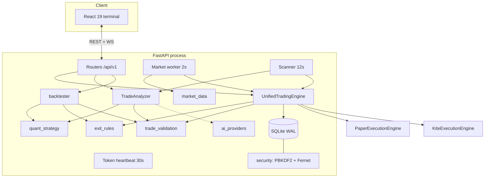
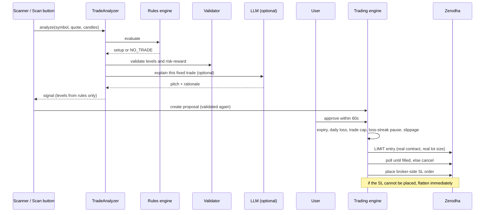

# Architecture

This document explains how TradeSentinel is put together and, more importantly, why. It matches the code in this repository.

## 1. Goals

1. **Never let a bug or a model hallucination place a bad order.** Decisions come from deterministic rules; everything else is validation and guard rails.
2. **Keep the same logic in live trading and in the backtest.**
3. **Stay recoverable.** A crash, restart or lost connection must not leave an unprotected or mis-tracked position.
4. **Keep secrets encrypted at rest** without requiring any infrastructure.

## 2. Component map

| Module | Responsibility |
| :-- | :-- |
| `app/main.py` | App factory, CORS, request-audit middleware, lifespan that starts and cancels the background workers |
| `app/api/v1/endpoints/*` | Thin HTTP layer: auth, market, trades, settings, backtest, websocket |
| `quant_strategy.py` | The rules engine. Pure function of candles + quote: returns actionable setup with levels, or `NO_TRADE` with a reason |
| `trade_validation.py` | Pure checks on any signal: level ordering, stop distance, minimum risk-reward, option-label detection |
| `trade_analyzer.py` | Calls the rules engine, validates, then optionally asks the LLM for wording. Never lets the LLM alter numbers |
| `ai_providers.py` | One function, `generate_json`, over Gemini / OpenAI / Anthropic. Provider, model and keys are read from the vault on every call |
| `exit_rules.py` | Stop, target and three-tier trailing logic. One pure function used by both live and backtest |
| `kite_executor.py` | `KiteExecutionEngine` (broker adapter) and `UnifiedTradingEngine` (orchestration, risk limits, reconciliation) |
| `core/paper_executor.py` | Simulated fills with a virtual balance |
| `core/interfaces.py` | Abstract contracts so brokers, data feeds and analyzers can be swapped |
| `backtester.py` | Replays candles through the same rules and exits, with costs |
| `market_data.py` | Quote polling, candle fetch, indicator enrichment (`technical_indicators.py`) |
| `security.py`, `database.py` | Key derivation, encryption, sessions, login throttling, repository layer |

## 3. From signal to order

Guards in `approve_trade` run **server-side**, so a modified client cannot bypass them. They run in this order: proposal state and expiry, daily loss circuit breaker, trade cap and loss-streak pause (`_check_trading_limits`), price drift from the proposed entry (`_check_entry_drift`), and finally "LIVE selected but broker not connected" is an error, never a silent paper fill.

## 4. Live order lifecycle

The part of the system where mistakes cost real money, so it is written defensively.

- **Contract resolution.** Rules emit labels like `BANKNIFTY 52000 CE`. `resolve_nfo_contract` maps these to the real exchange tradingsymbol (nearest non-expired expiry) and the true lot size from Kite's instrument dump, cached per day. Order quantity is lots × lot size.
- **Entry.** A LIMIT order at the approved price, rounded to the 0.05 tick. `_await_terminal` polls order history. If it has not filled within the timeout it is cancelled and re-checked, so a late fill cannot create a position the app does not know about. Partial fills use the actual filled quantity.
- **Protection.** Immediately after a fill, an `SL` order is placed at the broker. Its trigger follows the software trailing stop via `modify_order` (`_sync_trailing_stop`). If placing it fails, `exit_position` flattens at once and the failure is reported.
- **Exit.** `close_live` first inspects the protective stop. If it already filled, that fill is the exit and no new order is sent. Otherwise the stop is cancelled **and confirmed cancelled** before a market exit is sent, so two sells can never both execute. `exit_position` records its order id; a retry after a timeout inspects that order instead of placing another.
- **Bookkeeping.** A position is marked closed only after the broker confirms. If confirmation fails, the exception propagates and the position stays open, to be retried on the next tick.
- **Reconciliation.** Once per Kite session (and on demand at `/api/trade/reconcile`) tracked positions are compared with the broker's net positions. Positions already flat at the broker, for example because the stop fired while the app was offline, are booked at the stop's real fill price. Broker positions the app does not track are reported, not touched.

## 5. Concurrency model

- One asyncio event loop runs the HTTP server and three background tasks: market sync and P&L monitor (2 s), Kite token heartbeat (30 s), and the opportunity scanner (12 s).
- Broker calls are blocking SDK calls, so the long ones (`approve_trade`, startup reconcile, backtests) are pushed to worker threads with `asyncio.to_thread`.
- `UnifiedTradingEngine` holds a re-entrant lock around approvals and closes, so an auto-exit and a manual close cannot both send an exit order.
- Trade-offs: shared in-memory dictionaries are guarded only where it matters most (order entry and exit). A production system would move position state behind a repository with transactions.

## 6. Security

- A **master password** is hashed with PBKDF2-HMAC-SHA256 (random 16-byte salt, constant-time compare) for verification.
- A separate **Fernet key** is derived from the password with its own salt and held **only in memory** while unlocked. API keys, tokens and webhook URLs are encrypted with it before they touch SQLite. Logging out wipes the key.
- Sessions are random 32-byte tokens held in memory with a fixed 24-hour lifetime. The WebSocket authenticates with the same token.
- `POST /api/auth/login` is throttled: five failures lock the client out for 60 seconds.
- The request-logging middleware redacts passwords, tokens and secrets from logs.
- AI provider keys follow the same vault path as broker keys and are never returned by the API (only a masked preview).

**Known trade-offs:** 100,000 PBKDF2 iterations is below the current OWASP recommendation for SHA-256 (600,000); changing it needs a vault migration. The WebSocket token travels in the query string, which is convenient for browsers but can appear in access logs (the app masks it in its own logs).

## 7. Data model (SQLite, WAL mode)

| Table | Purpose |
| :-- | :-- |
| `trade_suggestions` | Every proposal with its levels, rationale and final status (approved, rejected, expired) |
| `positions` | Open and closed positions, including the broker symbol, protective-stop order id and exit order id for live trades |
| `orders` | Immutable audit trail of entries and exits with fill prices |
| `auth_config` | Password hash, salts, initialisation flag |
| `secure_vault` | Fernet-encrypted key/value secrets |

Discipline limits are computed from `positions`, so they survive restarts. Schema changes are additive `ALTER TABLE` migrations at startup.

## 8. Backtester design

`backtester.run_backtest` is deliberately thin: it feeds growing slices of the candle frame to `quant_engine.evaluate_quantitative_setup(..., as_of=bar_time)` and walks each trade forward with `exit_rules.check_exit_triggers`, so any change to the strategy or the exits is automatically reflected in both. Choices that avoid flattering the results:

- signals are formed on a bar's close and filled at the **next bar's open**;
- when one bar touches both stop and target, the **stop is assumed first**;
- gaps through a level exit at the open, not at the level;
- Indian intraday costs and per-side slippage are charged on every trade;
- the same trade cap, loss pause and post-loss lockout apply.

Because the rules are fixed, the three-fold split measures *stability over time* rather than doing parameter optimisation, and the result warns when fewer than 30 trades make any conclusion meaningless.

## 9. Frontend

React 19 + TypeScript (strict), organised by feature (`auth`, `market`, `trading`, `settings`, `voice`). A single typed API client wraps `fetch` with the Bearer token and a global 401 handler. A WebSocket hook streams ticks with reconnect/backoff. Charts use TradingView Lightweight Charts. Voice commands use the browser Web Speech API.

## 10. Testing

81 tests run in CI. Highlights:

- **Fake Kite client** (`tests/test_reliability.py`) exercises the real order lifecycle: contract resolution, unfilled-entry cancellation, protective stop placement, stop-failure flattening, stop-already-filled exits, and "no duplicate exit after a timeout".
- **Backtester tests** use hand-built candles to prove entry timing, stop-before-target ordering, square-off, and net = gross − charges.
- **LLM boundary tests** prove a rejected setup never reaches the model and that a model cannot move a price level.
- **Security and API tests** cover the vault, sessions, log redaction and login throttling.
