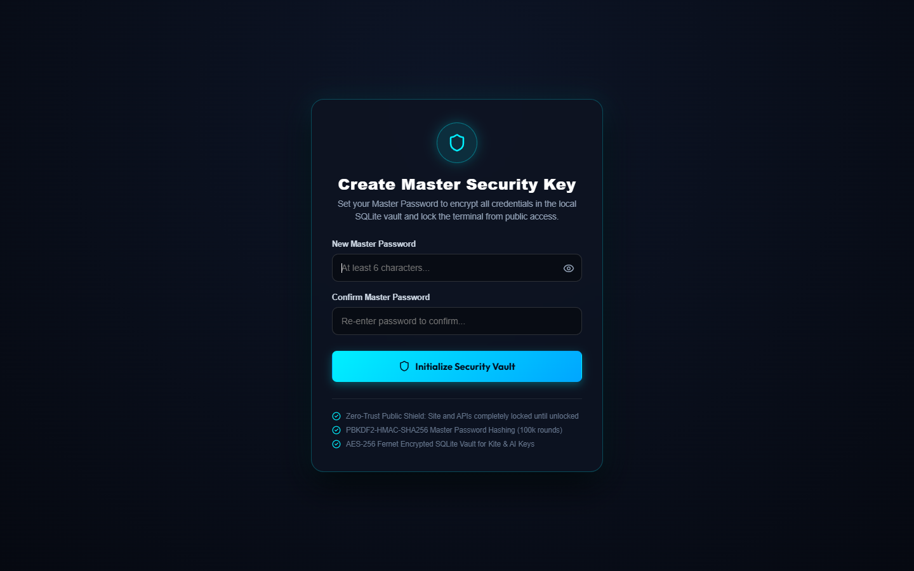
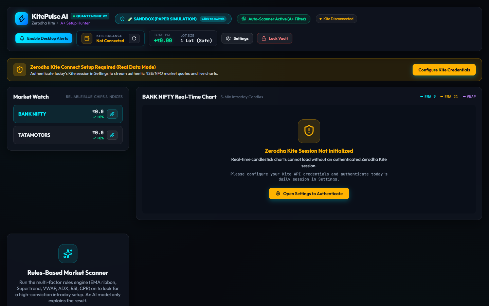
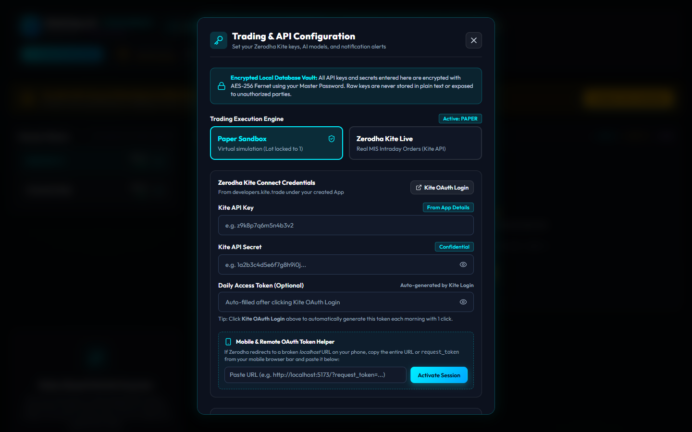
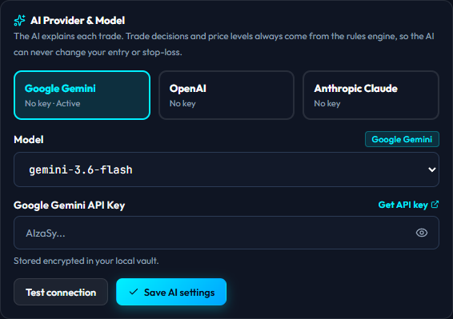
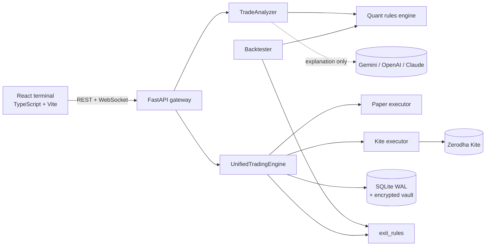

# KitePulse AI

**A rules-first intraday trading assistant for Indian markets (NSE/NFO) with human approval, broker-side risk controls, a cost-aware backtester and a pluggable LLM layer.**

[](https://github.com/dipesh9765/KitePulse-AI/actions/workflows/ci.yml)
[](https://www.python.org/)
[](https://fastapi.tiangolo.com/)
[](https://react.dev/)
[](https://www.typescriptlang.org/)
[](LICENSE)

> **Disclaimer.** This is an engineering project, not financial advice. The strategy has **not** been shown to be profitable, and trading derivatives can lose more than you expect. Run it in PAPER mode, backtest on real data, and understand the [limitations](#known-limitations) before risking any money.

---

## What it does

1. **Scans** a watchlist of NSE indices and stocks on 5-minute candles using a deterministic multi-factor rules engine (EMA ribbon, Supertrend, session VWAP, ADX/DMI, RSI, CPR/pivots, volume).
2. **Proposes** a trade with entry, stop-loss and two targets. Every proposal is validated (stop on the correct side, minimum 1:1.8 risk-reward) before it exists.
3. **Waits for you.** Nothing is sent to the broker until you approve it by click, keyboard or voice, within 60 seconds.
4. **Executes** in a paper sandbox or live on Zerodha Kite, placing a **broker-side stop-loss** with every entry so a crash or lost connection does not leave a position unprotected.
5. **Backtests** the exact same rules and exit logic on historical candles, with realistic Indian intraday costs and slippage.

An LLM (Gemini, OpenAI or Claude, chosen in the UI) only writes the human-readable explanation. **It cannot change a trade decision or move a price level.**

## Screenshots

Captured from a fresh install in PAPER mode with no broker connected, so the terminal shows its honest empty state: the app never fabricates prices.

| Create the encrypted vault | Trading terminal |
| :-: | :-: |
|  |  |

| Configuration | Choose the AI provider and model |
| :-: | :-: |
|  |  |

## Design principles

| Principle | How it is enforced |
| :-- | :-- |
| Rules decide, the LLM explains | `trade_analyzer.py` takes every level from the rules engine; if the LLM's spoken pitch quotes different prices, it is discarded |
| Never trade a malformed signal | `trade_validation.py` checks level ordering, stop distance and risk-reward before a proposal can be created |
| A position is only "closed" when the broker says so | Live exits place a real order, wait for confirmation, and never send a second exit while one is unresolved |
| Fail safe, not silent | LIVE mode refuses to fall back to paper; if a protective stop cannot be placed, the position is flattened immediately |
| Discipline over opportunity | Daily loss limit, trades-per-day cap, and a timed pause after consecutive losses, all counted from the database so restarts do not reset them |
| Test what you trade | The backtester imports the same `quant_strategy` and `exit_rules` modules the live system uses |

## Architecture at a glance



More detail, including the live order lifecycle and concurrency model, is in [ARCHITECTURE.md](ARCHITECTURE.md).

## Risk controls

| Control | Default | Setting |
| :-- | :-- | :-- |
| Lot cap | 1 lot | `GenConsts.MAX_LOT_SIZE` |
| Human approval window | 60 s (server-enforced) | |
| Minimum risk-reward | 1 : 1.8 | `trade_validation.MIN_RISK_REWARD` |
| Daily loss circuit breaker | ₹2,000 | `MAX_DAILY_LOSS` |
| Trades per day | 5 | `MAX_TRADES_PER_DAY` |
| Pause after consecutive losses | 3 losses, 60 min | `MAX_CONSECUTIVE_LOSSES`, `LOSS_STREAK_PAUSE_MINUTES` |
| Post-loss symbol lockout | 45 min | |
| Entry slippage guard | 1% equity / 5% options | blocks the trade |
| Broker-side stop-loss | every live entry | trails with the software stop |
| Auto square-off | 15:15 IST | |
| Login throttling | 5 failures, 60 s lockout | `security.py` |

## Backtesting

```bash
cd backend
python backtester.py --csv bank_nifty_5m.csv --symbol "BANK NIFTY"
```

CSV columns: `timestamp` (or `date`), `open`, `high`, `low`, `close`, `volume`. With a Kite session active you can also call `POST /api/backtest` with `{"symbol": "BANK NIFTY", "days": 30}`.

The simulation enters on the **next bar's open**, assumes the **stop is hit before the target** inside a bar, charges brokerage, STT, exchange fees, stamp duty, GST and slippage, applies the same trade cap and loss pause as live, and squares off at 15:15. Output includes win rate, profit factor, expectancy (₹ and R), max drawdown, losing streaks, and **three chronological folds** to show whether any edge is stable over time. It warns when there are too few trades to conclude anything.

## Tech stack

| Layer | Technology |
| :-- | :-- |
| API | FastAPI, Uvicorn, Pydantic v2, asyncio workers |
| Broker | Zerodha KiteConnect v5 |
| AI | Google GenAI SDK, plus OpenAI and Anthropic over HTTPS (`httpx`) |
| Data | Pandas, NumPy |
| Storage | SQLite (WAL), Fernet-encrypted vault with PBKDF2-derived key |
| Frontend | React 19, TypeScript, Vite, TradingView Lightweight Charts v5 |
| Quality | Pytest (81 tests), GitHub Actions CI, oxlint, strict `tsc` |

## Quick start

Requirements: Python 3.11+, Node 20+. A Zerodha Kite Connect account is optional; PAPER mode needs no credentials.

```bash
# Backend
cd backend
python -m venv venv
venv\Scripts\activate            # Windows   (Linux/macOS: source venv/bin/activate)
pip install -r requirements.txt
cp .env.example .env             # optional; everything can be set in the UI
pytest -q
uvicorn main:app --host 127.0.0.1 --port 8000 --reload
```

```bash
# Frontend (second terminal)
cd frontend
npm ci
npm run dev                      # http://localhost:5173
```

On Windows, `start_all.bat` launches both. Open the UI, create a master password (it encrypts your stored keys), then open **Settings** to add Kite credentials and choose an **AI provider and model**.

## Configuration

Credentials are entered in the UI and stored encrypted. Optional environment variables (see [`backend/.env.example`](backend/.env.example)):

| Variable | Purpose | Default |
| :-- | :-- | :-- |
| `TRADING_MODE` | `PAPER` or `LIVE` | `PAPER` |
| `MAX_DAILY_LOSS` | Circuit breaker in ₹ | `2000` |
| `MAX_TRADES_PER_DAY` | Entry cap | `5` |
| `MAX_CONSECUTIVE_LOSSES` | Losses before pause | `3` |
| `LOSS_STREAK_PAUSE_MINUTES` | Pause length | `60` |
| `KITE_*`, `GEMINI_API_KEY` | Optional headless defaults | empty |

Tracked instruments live in [`backend/instruments.json`](backend/instruments.json).

## API overview

Interactive docs are served at `/docs`. Everything except auth bootstrap requires a Bearer token.

| Area | Endpoints |
| :-- | :-- |
| Auth | `POST /api/auth/setup`, `POST /api/auth/login`, `POST /api/auth/logout`, `GET /api/auth/status` |
| Market | `GET /api/market/quotes`, `GET /api/market/candles`, `GET /api/status` |
| Trading | `POST /api/trade/scan`, `/approve`, `/reject`, `/close-position`, `/reconcile`; `GET /api/trade/positions`, `/orders`, `/portfolio`, `/history` |
| AI | `GET/POST /api/ai/config`, `POST /api/ai/test` |
| Backtest | `POST /api/backtest` |
| Settings | `GET/POST /api/settings`, `POST /api/settings/mode`, `GET /api/kite/login-url`, `POST /api/kite/session` |
| Stream | `WS /ws/live?token=…` (2 s ticks: quotes, positions, P&L) |

## Project structure

```
backend/
  app/                  FastAPI package: routers (api/v1/endpoints), schemas, lifespan workers
  core/                 Interfaces (executor, analyzer, provider) and the paper executor
  quant_strategy.py     Multi-factor rules engine
  exit_rules.py         Stop / target / trailing logic shared by live and backtest
  trade_validation.py   Signal sanity checks
  trade_analyzer.py     Rules-gated analyzer; LLM writes the explanation only
  ai_providers.py       Gemini / OpenAI / Anthropic gateway
  kite_executor.py      Live and unified trading engines, risk limits, reconciliation
  backtester.py         Cost-aware replay of the live rules
  market_data.py        Kite quotes and candle ingestion
  security.py, database.py, server_logger.py, notifications.py, scanner.py
  tests/                81 tests (fake Kite client for the live order lifecycle)
frontend/src/
  features/             auth, market (chart, watchlist), trading, settings, voice
  services/             API client, speech, sound, notifications
.github/workflows/      CI: backend tests, frontend build and lint
```

## Known limitations

Being upfront about these matters more than a long feature list.

- **No proven edge.** The rules are a reasonable, conventional confluence strategy. Whether they make money after costs must be established with the backtester on real data, then with weeks of paper trading.
- **Option backtests are approximate.** There is no historical option price feed here, so index trades use a delta proxy on the underlying (no theta, gamma or IV).
- **Targets are software-managed.** Only the stop-loss rests at the broker. Zerodha has no OCO for MIS orders, so a resting target alongside the stop could double-fill.
- **Live trading needs an unlocked session.** Credentials live in an encrypted vault that is unlocked in memory after login; exits and reconciliation need that session. The broker-side stop covers the gap if the app goes down.
- **Fixed-rule strategy.** No parameter optimisation or regime detection.
- **Single-user design.** In-memory sessions and a local SQLite database; not built for multi-tenant deployment.
- **The live order code has been verified against a fake broker only.** Treat first live use as a supervised test with the smallest size.

## License

MIT, see [LICENSE](LICENSE).
